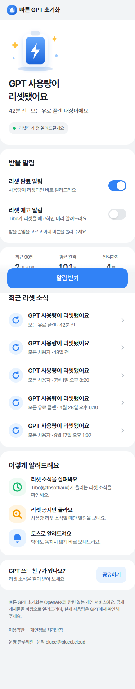
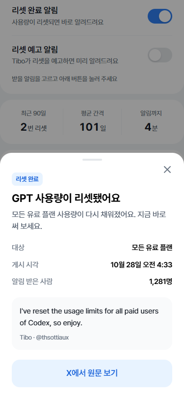
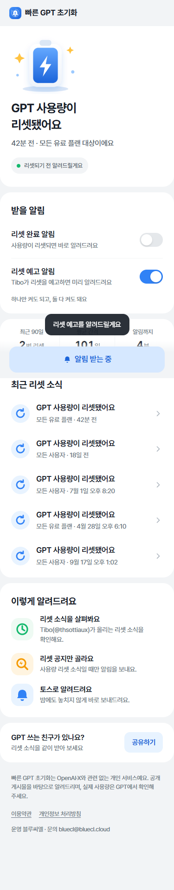

# gpt_reset · 빠른 GPT 초기화

OpenAI Codex 팀의 Tibo([@thsottiaux](https://x.com/thsottiaux))가 X에 사용량 리셋 소식을 올리면 토스 메시지로 알려 주는 앱인토스 미니앱이에요. 10분마다 새 게시물을 확인해요.

  

모든 기능은 무료예요. 인앱결제·광고는 없어요.

## 동작 방식

```text
systemd 타이머(10분) → scripts/poll.ts → X API v2(X_BEARER_TOKEN 있을 때) 또는 codex-reset.com 공개 타임라인(기본, 검증된 리셋만)
  → shared/reset.ts 규칙 분류 (reset / planned / none, auto / review)
  → SQLite 기록 → 토스 스마트 발송(mTLS) → 구독자
미니앱 → GET /api/feed (최근 리셋) · POST /api/session · PUT /api/subscription
```

- **자동 발송**: 최근 90분 안에 올라온 글이 완료형 리셋 공지(“I have reset… limits”)일 때만 바로 보내요.
- **운영자 확인**: 예고(“will reset tonight”), 답글, 사용량 문맥이 약한 글은 `pending`으로 두고 `npm run admin -- send <id>`로 보내요. `NOTIFY_MODE=review`면 모든 글을 확인 후 보내요.
- **첫 실행**은 기존 글을 기록만 하고 알림을 보내지 않아요. 같은 게시물은 두 번 보내지 않아요.
- **발송 방식**: 구독자 50명 미만이거나 야간(KST 21~08시, 대량 발송이 보류되는 시간)이면 단건 발송, 그 외는 2,500건 단위 대량 발송이에요.
- **사용자 식별**: `User.createAnonymousKeyAuthCode()` 코드 → 서버가 앱인토스 API로 교환해서 `anonKey`를 받아요. 앱에는 앱 전용 세션 토큰만 주고 식별키는 돌려주지 않아요. 토큰은 해시만 저장해요.
- **해지**: 알림을 끄면 바로 발송 대상에서 빠지고, 30일 뒤 식별키를 지워요(`store.purge()`, 수집할 때마다 실행).

## 로컬 실행

```powershell
npm ci
Copy-Item .env.example .env      # TOSS_MOCK=true 로 두면 토스 API 없이 확인할 수 있어요
$env:TIBO_SEED_DEMO='true'; npm run dev   # 예시 데이터로 화면 확인
```

[localhost:5174](http://localhost:5174)에서 확인해요. 브라우저에서는 알림 동의와 인증 코드가 개발용 값으로 대체돼요.

## 검증

```powershell
npm test            # 분류기·수집기·발송·API 단위 테스트 20개
npm run test:e2e    # Edge 375·768·1440px 흐름 10개 (스크린샷 docs/screenshots 갱신)
npm run build:web   # 타입 검사 + 번들
npm run bundle:preview   # 로컬 검토용 tibo.ait
npm run build       # 출시용. .env.production의 VITE_API_BASE_URL(HTTPS)·VITE_TOSS_RESET_TEMPLATE·VITE_TOSS_PLAN_TEMPLATE(tibo-) 필수
npx ait deploy      # 콘솔 업로드 (테스트 링크 출력)
```

## 출시 전에 준비할 것

| 항목 | 위치 |
|---|---|
| 앱 이름 `tibo`, 로고 `docs/brand/logo-600.png` | 앱인토스 콘솔 |
| mTLS 인증서 → `TOSS_MTLS_CERT`·`TOSS_MTLS_KEY` | 콘솔 › 개발 › mTLS 인증서 |
| 기능성 캠페인 2개: 리셋 완료 `tibo-reset`, 리셋 예고 `tibo-plan`. 같은 알림동의문을 둘 다에 연결하고 검수 승인 | 콘솔 › 푸시알림 |
| X API Bearer 토큰 → `X_BEARER_TOKEN` | developer.x.com (pay-per-use) |

캠페인 문구는 고정 문장이에요(리셋 완료: 제목 `리셋됐어요` / 본문 `GPT 사용량이 다시 채워졌어요.`). 서버는 `title`·`summary`·`scope`·`postedAt`도 함께 보내지만 문구에 쓰지 않으면 무시돼요. 앱은 고른 알림마다 해당 캠페인 코드로 `Notification.requestAgreement`를 호출해요. 같은 동의문이면 두 번째는 화면 없이 넘어가요.

X API 비용 참고: since_id로 새 글만 받아요. 하루 144회 확인 중 새 글이 없으면 읽기 비용이 거의 들지 않아요. 정확한 요금은 X 개발자 콘솔의 공식 요금표를 확인해 주세요.

## 배포 (BlueCL · 2026-10-28 설치됨)

현재 릴리스 `tibo-20261028050540`, API `https://bluecl.cloud/tibo/api/`, nginx 백업 `/var/backups/tibo/20261027T175016Z`.

`deploy/`에 사용자 systemd 유닛과 nginx 경로가 있어요. API 포트는 `18825`, 공개 경로는 `https://bluecl.cloud/tibo/api/`예요.

업데이트: `server shared scripts deploy package*.json tsconfig.json`을 `releases/<rel>.tar.gz`로 올린 뒤 `bash deploy/release.sh <rel>`을 실행해요. 의존성 설치 → `current` 교체 → 재시작 → 상태 확인을 하고, 실패하면 이전 릴리스로 되돌려요. 발송 코드 2개도 `.env`에 넣어요.

최초 설치:

```sh
# 서버: /home/solty/dev/tibo/{current,node,data,certs,.env}
npm ci --omit=dev --ignore-scripts
cp deploy/tibo.service deploy/tibo-poll.service deploy/tibo-poll.timer ~/.config/systemd/user/
systemctl --user daemon-reload
systemctl --user enable --now tibo.service tibo-poll.timer
sudo bash /home/solty/dev/tibo/current/deploy/install-proxy.sh   # 한 번만: 백업 → include 추가 → nginx -t (실패 시 자동 복구) → reload
```

bluecl.cloud는 Cloudflare 규칙 `BlueCL - restrict methods and private paths`와 nginx 서버 블록에서 GET 외 요청을 막아요. 두 곳 모두 `/tibo/api/` 예외가 들어가 있어요. mTLS 인증서는 `/home/solty/dev/tibo/certs/`(600)에 있고 2027-11-21에 만료돼요.

`.env`에 `NODE_ENV=production`, `PORT=18825`, `TIBO_DB_PATH=/home/solty/dev/tibo/data/tibo.sqlite`를 넣어요. 운영 환경에서는 `TOSS_MOCK=true`를 거부해요. 서버 Node는 22.13 이상(`node:sqlite`)이 필요해요.

운영 확인:

```sh
systemctl --user list-timers tibo-poll.timer
journalctl --user -u tibo-poll.service -n 30 --no-pager
npm run admin -- stats | list | send <id> | skip <id>
```

## 구조

```text
shared/reset.ts     리셋 분류 규칙, 한국어 문구, 시간 표기
server/source.ts    codex-reset.com 타임라인(기본) · X API v2 수집
server/poller.ts    1회 수집·분류·발송
server/toss.ts      앱인토스 파트너 API(mTLS) · 개발용 mock
server/store.ts     SQLite (구독자·세션·게시물·이벤트)
server/app.ts       공개 API (CORS 허용 목록, 요청 제한)
src/                React 화면, 토스 SDK 연동, SVG 일러스트
scripts/            poll · admin · 출시 검사 · 로고 렌더링
deploy/             systemd · nginx · release.sh
```

## UI/UX 점검

ui-ux-pro-max 스킬의 출시 전 점검표로 확인했어요: SVG 아이콘(이모지 없음), 클릭 가능한 요소의 포인터, 150~300ms 전환, 본문 대비 4.5:1 이상(작은 파란 글자는 #1b64da로 교체), 키보드 초점 표시와 시트 닫은 뒤 초점 복귀, 움직임 줄이기 설정, 375·768·1440px 화면, touch-action·overscroll·dvh 처리.

## 유의 사항

- 화면 용어는 GPT로 통일했어요(영어 원문 인용은 그대로). OpenAI·X와 제휴하지 않은 개인 서비스예요. 앱 하단과 약관에 표시돼요. 상표 사용과 앱 이름은 콘솔 검수에서 다시 확인해 주세요.
- 기본 데이터는 codex-reset.com 공개 API예요. 이 API는 데이터가 보이는 화면에 출처 링크를 다는 조건으로 무료예요. 요청에 따라 화면 출처 표기를 뺐기 때문에 차단될 수 있어요(User-Agent에는 연락처를 넣고 있어요). X API 토큰을 넣으면 X를 직접 읽어요. 비공식 스크래핑은 쓰지 않아요.
- 분류는 영어 규칙 기반이라 새 표현은 놓칠 수 있어요. 놓친 글은 `admin list`에서 확인하고 `tests/reset.test.ts`에 사례를 추가해 규칙을 넓혀요.
- 실기기 토스 앱에서의 동의문·인증 코드·메시지 수신은 콘솔 설정 후 직접 테스트해야 해요.
